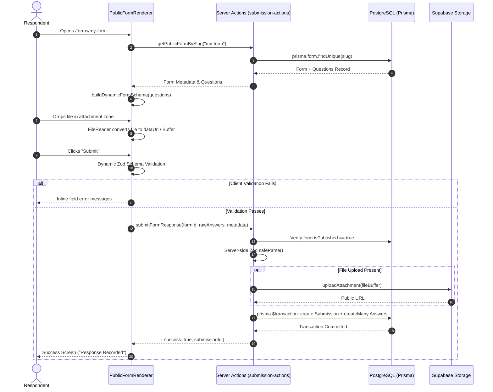
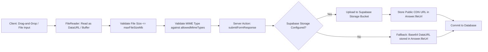

# Technical Handoff & Architecture Specification
**Platform:** In-House Dynamic Form Management Engine (`FormMaker`)  
**Version:** 1.0.0-prototype  
**Runtime:** Node.js 20+ / Next.js 16.3 (Turbopack) / React 19 / PostgreSQL (Prisma 6.4)  
**Status:** Architecture Audit & Handoff Specification  

---

## 1. Executive Summary & Product Scope

### 1.1 High-Level Overview
`FormMaker` is a self-hostable, production-ready form creation, distribution, and data-collection web platform built as an in-house alternative to SaaS solutions like Google Forms, Typeform, and Jotform. The system eliminates third-party per-seat subscription costs, prevents sensitive organizational data from leaving internal boundaries, and provides a fully extensible canvas for custom field types and bespoke backend integrations.

### 1.2 Core Problem Solved & Operational Model
Commercial form platforms impose restrictive payload caps, lack self-hosted air-gapped deployment capability, and trap collected data in proprietary clouds. `FormMaker` addresses these problems with:
- **Zero-Cloud Dependency Option:** Operates seamlessly on internal Docker environments or Supabase-managed PostgreSQL instances.
- **Strict State Separation:** Form structure validation and dynamic field schemas are decoupled from transient UI interactions, avoiding performance bottlenecks on large forms.
- **Runtime Schema Compilation:** Public forms do not rely on hardcoded fields. They compile dynamic Zod validation schemas in real-time from database metadata.
- **Dual Localization Native:** Ships with built-in instant English/Turkish language switching (`TR` / `EN`) with SSR-safe hydration and zero bundle bloat.

### 1.3 Primary User Workflows

```mermaid
flowchart TD
    subgraph Admin_Workflow["Admin Workflow"]
        A1[Dashboard: List Forms] --> A2[Create Blank Form]
        A2 --> A3[Builder Canvas: Add / Arrange Questions]
        A3 --> A4[Field Inspector: Configure Constraints & Options]
        A4 --> A5[Settings: Custom Slug & Live Toggle]
        A5 --> A6[Atomic Draft / Publish Save]
        A6 --> A7[Live Preview in New Tab]
        A1 --> A8[Responses View: Filter & Table Inspection]
        A8 --> A9[Detail Sheet: Download Attachments]
        A8 --> A10[RFC 4180 CSV Export]
    end

    subgraph Respondent_Workflow["Respondent Workflow"]
        R1[Visit Public URL: /forms/slug] --> R2{Is Published or Preview?}
        R2 -- No --> R3[Form Not Active Screen]
        R2 -- Yes --> R4[Fetch Form & Question Schema]
        R4 --> R5[Runtime Dynamic Zod Compilation]
        R5 --> R6[Client Validation & Input Entry]
        R6 --> R7[File Upload: Drag-and-Drop / Base64 / Storage]
        R7 --> R8[Server Action: submitFormResponse]
        R8 --> R9[Atomic DB Write: Submission + Answer Rows]
        R9 --> R10[Success Confirmation & Reset Option]
    end
```



---

## 2. Complete Tech Stack & Dependency Matrix

| Package Name | Version | Responsibility / Feature Mapping | Rationale vs. Alternatives | Key Files Utilizing It |
| :--- | :--- | :--- | :--- | :--- |
| **`next`** | `16.3.8` | Core web framework, React 19 Server Components, App Router, Server Actions, Turbopack engine. | Native Server Actions eliminate standalone API route boilerplate; Turbopack delivers sub-second incremental builds. | `src/app/**`, `next.config.ts`, `src/actions/**` |
| **`react`** / **`react-dom`** | `19.2.8` | UI runtime, concurrent mode, transitions (`useTransition`), external store synchronization. | Modern baseline supporting React 19 Action hooks and strict hydration boundaries. | All `.tsx` components |
| **`typescript`** | `^5.0.0` | Static typing, recursive schema inference, strict type safety. | Prevents schema mismatches between DB models, RHF values, and Zod inference. | `tsconfig.json`, `src/types/form.ts` |
| **`@prisma/client`** / **`prisma`** | `^6.4.1` | Relational ORM for PostgreSQL; schema definitions, migrations, and query generation. | Type-safe queries, relation joins, and atomic transaction primitives (`prisma.$transaction`). | `prisma/schema.prisma`, `src/lib/prisma.ts`, `src/actions/**` |
| **`react-hook-form`** | `^7.89.0` | Form state management, dynamic array management (`useFieldArray`), controlled input binding. | Uncontrolled re-render isolation prevents canvas lag when typing into large multi-field forms. | `src/components/builder/builder-canvas.tsx`, `src/components/public/public-form-renderer.tsx` |
| **`zod`** | `^3.24.2` | Static schema validation and dynamic runtime schema synthesis. | Generates dynamic schemas at runtime using `z.object(shape)` on respondent submission. | `src/lib/validations/form.ts`, `src/lib/validations/dynamic-schema.ts` |
| **`@hookform/resolvers`** | `^5.9.1` | Bridge connecting Zod schemas directly into React Hook Form validation. | Standardized error message mapping between Zod parse errors and RHF `formState.errors`. | `src/components/builder/form-builder.tsx`, `src/components/public/public-form-renderer.tsx` |
| **`zustand`** | `^5.0.3` | Ephemeral builder workspace state (active question selection, inspector toggle, temporal history). | Avoids React Context re-render cascades; centralizes undo/redo history without polluting question data. | `src/stores/use-builder-store.ts`, `src/components/builder/form-builder.tsx` |
| **`@supabase/supabase-js`** | `^2.117.2` | Client for Supabase Storage buckets (attachment uploads, public URL generation). | Decouples file uploads from database storage when configured; provides scalable binary storage. | `src/lib/storage.ts` |
| **`tailwindcss`** / **`@tailwindcss/postcss`** | `^4.0.0` | Utility-first CSS engine using modern CSS variables and Tailwind v4 PostCSS pipeline. | Zero-runtime CSS generation with precise responsive breakpoints and theme token integration. | `src/app/globals.css`, `postcss.config.mjs` |
| **`next-themes`** | `^0.4.6` | Theme switching (light/dark/system) using HTML class injection. | Prevents flash of unstyled theme (FOUT) and persists selection across sessions. | `src/components/theme-provider.tsx`, `src/components/theme-toggle.tsx` |
| **`lucide-react`** | `^1.52.0` | Comprehensive UI iconography. | Consistent 24px icon set across question types, controls, headers, and inspector. | All UI component files |
| **`sonner`** | `^2.0.8` | Toast notification manager. | Non-blocking status feedback for saves, copies, deletions, and submission errors. | `src/app/layout.tsx`, `src/components/**` |
| **`clsx`** / **`tailwind-merge`** | `^2.1.1` / `^3.7.0` | Conditional class joining and Tailwind utility conflict resolution (`cn` utility). | Guarantees predictable CSS precedence when overriding base component styles. | `src/lib/utils.ts` |
| **`class-variance-authority`** | `^0.7.1` | Component variant definition (e.g., buttons, badges). | Type-safe styling variants for design system primitives. | `src/components/ui/button.tsx`, `src/components/ui/badge.tsx` |
| **`@base-ui/react`** | `^1.8.0` | Accessible unstyled primitives for headless dropdowns and popups. | Accessible keyboard navigation and ARIA attributes for complex selects. | `src/components/ui/select.tsx` |

---

## 3. File & Directory Architecture

```
form-maker/
├── prisma/
│   ├── schema.prisma                  # PostgreSQL schema: Form, Question, Submission, Answer models
│   └── migrations/                    # SQL migration history
├── public/                            # Static web assets
├── src/
│   ├── actions/                       # Next.js Server Actions (Mutation & Persistence Layer)
│   │   ├── form-actions.ts            # Form CRUD: listForms, getFormById, createForm, saveForm, deleteForm
│   │   ├── response-actions.ts        # Admin response queries: getFormResponses, deleteSubmission, exportCSV
│   │   └── submission-actions.ts      # Public respondent actions: getPublicFormBySlug, submitFormResponse
│   ├── app/                           # App Router routes & layouts
│   │   ├── layout.tsx                 # Root HTML shell: Fonts, ThemeProvider, LanguageProvider, Toaster
│   │   ├── page.tsx                   # Public landing page: Feature highlights, hero, admin gateway
│   │   ├── globals.css                # Global styles, Tailwind v4 imports, CSS theme variables
│   │   ├── admin/
│   │   │   └── forms/
│   │   │       ├── page.tsx           # Server Component: Fetches forms and renders FormsDashboardClient
│   │   │       └── [id]/
│   │   │           ├── edit/
│   │   │           │   └── page.tsx   # Builder Route: Fetches form by ID and mounts FormBuilder
│   │   │           └── responses/
│   │   │               └── page.tsx   # Redirect handler: Redirects to /admin/forms/[id]/edit?tab=responses
│   │   └── forms/
│   │       └── [slug]/
│   │           └── page.tsx           # Public Form Gateway: Validates publication status or ?preview=true
│   ├── components/                    # React UI components
│   │   ├── theme-provider.tsx         # NextThemesProvider client wrapper
│   │   ├── theme-toggle.tsx           # Light/Dark mode switcher button
│   │   ├── language-toggle.tsx        # English/Turkish language switcher button (Globe + TR/EN badge)
│   │   ├── admin/
│   │   │   ├── forms-dashboard-client.tsx # Client dashboard: Summary statistics cards, form list, filter
│   │   │   ├── create-form-button.tsx     # Async button triggering createForm server action
│   │   │   └── form-card-actions.tsx      # Form card quick actions: Delete, Copy Link, Open Live
│   │   ├── builder/
│   │   │   ├── form-builder.tsx       # Root builder coordinator: RHF context, history, keyboard shortcuts
│   │   │   ├── builder-header.tsx     # Top bar: Title, dirty indicator, undo/redo, save, preview, tabs
│   │   │   ├── builder-canvas.tsx     # Canvas: Question list (useFieldArray), reorder, type select, add
│   │   │   ├── builder-inspector.tsx  # Sticky sidebar: Field config (labels, constraints, options, limits)
│   │   │   ├── builder-settings.tsx   # Settings tab: Metadata, slug validation, publication switch, delete
│   │   │   └── builder-live-preview.tsx # (Deprecated modal; replaced by new-tab ?preview=true route)
│   │   ├── public/
│   │   │   ├── public-form-renderer.tsx # Dynamic respondent form: RHF + runtime Zod validation, submission
│   │   │   └── form-not-active.tsx      # Friendly inactive/draft notice card with language toggle
│   │   ├── responses/
│   │   │   ├── responses-view.tsx     # Responses tab container: Summary stats, refresh, table, detail sheet
│   │   │   ├── responses-table.tsx    # Paginated data table with answer previews and action buttons
│   │   │   ├── response-detail-sheet.tsx # Drawer sheet displaying full answers, metadata, and attachments
│   │   │   └── export-csv-button.tsx  # Button generating RFC 4180 CSV export download
│   │   └── ui/                        # Reusable shadcn/ui design system primitives
│   │       ├── badge.tsx              # Status indicator badge
│   │       ├── button.tsx             # CVA-styled button component
│   │       ├── card.tsx               # Content container card
│   │       ├── checkbox.tsx           # Controlled checkbox element
│   │       ├── dialog.tsx             # Accessible modal dialog
│   │       ├── input.tsx              # Styled text input
│   │       ├── radio-group.tsx        # Accessible radio buttons
│   │       ├── select.tsx             # Dropdown select primitive with custom triggers
│   │       ├── separator.tsx          # Visual divider line
│   │       ├── sheet.tsx              # Slide-out drawer sheet
│   │       ├── sonner.tsx             # Toast viewport setup
│   │       ├── switch.tsx             # Accessible toggle switch
│   │       ├── table.tsx              # Responsive tabular presentation
│   │       ├── tabs.tsx               # Tab switcher primitive
│   │       ├── textarea.tsx           # Auto-expanding text area
│   │       └── tooltip.tsx            # Hover tooltip wrapper
│   ├── lib/                           # Core utilities, libraries, and validation schemas
│   │   ├── prisma.ts                  # Global PrismaClient singleton instance
│   │   ├── storage.ts                 # Supabase Storage client wrapper & fallback handler
│   │   ├── utils.ts                   # cn() class merge helper
│   │   ├── i18n/
│   │   │   ├── translations.ts        # Typed English & Turkish translation dictionaries
│   │   │   └── language-context.tsx   # LanguageProvider, useLanguage hook with useSyncExternalStore
│   │   └── validations/
│   │       ├── form.ts                # Zod schemas: questionItemSchema, formBuilderSchema, types
│   │       └── dynamic-schema.ts      # Runtime Zod schema compiler (buildDynamicFormSchema)
│   └── stores/
│       └── use-builder-store.ts       # Zustand store: UI state, selection, temporal history (undo/redo)
├── next.config.ts                     # Next.js configuration (serverActions.bodySizeLimit: 25mb)
├── package.json                       # Project dependencies and script declarations
├── tsconfig.json                      # TypeScript strict configuration and @/* path aliases
└── AGENTS.md                          # Next.js agent operational rules
```

---

## 4. State Management & Data Flow Architecture

### 4.1 Strict State Separation Architecture
A core architectural principle of `FormMaker` is the **separation of Form Definition Data from Ephemeral Workspace State**:

```
┌────────────────────────────────────────────────────────────────────────────────┐
│                           FORM BUILDER WORKSPACE                               │
├────────────────────────────────────────┬───────────────────────────────────────┤
│  FORM DEFINITION (React Hook Form)     │  EPHEMERAL WORKSPACE (Zustand Store)  │
├────────────────────────────────────────┼───────────────────────────────────────┤
│  • title (string)                      │  • activeQuestionId (string | null)   │
│  • description (string)                │  • isInspectorOpen (boolean)          │
│  • slug (string)                       │  • isSaving (boolean)                 │
│  • isPublished (boolean)               │  • lastSavedAt (Date | null)          │
│  • questions: QuestionItemValues[]     │  • isDirty (boolean)                  │
│    - id, orderIndex, type              │  • past: FormBuilderValues[] (History)│
│    - label, required                   │  • future: FormBuilderValues[]        │
│    - options: ChoiceOption[]           │  • canUndo / canRedo (boolean)        │
│    - config: QuestionConfig            │                                       │
│                                        │  (Partialized: Workspace UI state is  │
│  (Managed via useFieldArray & RHF      │   never stored in the undo stack)     │
│   validation resolver)                 │                                       │
└────────────────────────────────────────┴───────────────────────────────────────┘
```

### 4.2 Temporal History (Undo / Redo) Mechanics
The temporal history is managed inside `src/stores/use-builder-store.ts` and synchronized through `src/components/builder/form-builder.tsx`:
1. **Debounced Snapshot Capture:** Changes emitted by RHF's `useWatch` are observed. When the form is marked dirty and values diverge from the previous snapshot, a 600ms debounce timer triggers `pushHistory(previousSnapshot)`.
2. **Mount Protection:** Initial mount values are blocked from entering the history stack using `isInitialMountRef.current` and an initial 400ms stabilization window.
3. **State Partialization:** The temporal stack stores *only* `FormBuilderValues` (the form content). UI selections like `activeQuestionId` and `isInspectorOpen` are excluded. When undoing, if the active question no longer exists, the builder safely resets selection to `previous.questions[0].id` without crashing.
4. **Restoration Guard:** During undo/redo execution, `isApplyingHistoryRef.current = true` prevents the restoration from re-triggering the change listener and polluting the stack.
5. **Keyboard Shortcuts:** Global event listeners capture `Ctrl+Z` (Undo), `Ctrl+Shift+Z` / `Ctrl+Y` (Redo) with `e.preventDefault()`.

### 4.3 Inspector Panel Synchronization
The sticky inspector sidebar ([`src/components/builder/builder-inspector.tsx`](file:///c:/Users/erdem%20koyuncu/Desktop/erdem/code/form-maker/src/components/builder/builder-inspector.tsx)) resolves the active question using a dual-check strategy:
```ts
const activeIndex = React.useMemo(() => {
  if (!activeQuestionId) return questions.length > 0 ? 0 : -1;
  const qIndex = questions.findIndex((q) => q?.id === activeQuestionId);
  if (qIndex !== -1) return qIndex;
  const fIndex = fields.findIndex((f) => f.id === activeQuestionId);
  if (fIndex !== -1) return fIndex;
  return questions.length > 0 ? 0 : -1;
}, [activeQuestionId, questions, fields]);
```
- Modifications in the inspector bind directly to `questions.${activeIndex}.<field>` via RHF `register` or `setValue(..., { shouldDirty: true })`.
- Because both canvas cards and the inspector read from the same `FormProvider` context, changes propagate instantly with zero state duplication.

### 4.4 Public Respondent Engine & Runtime Schema Generation
When a respondent navigates to `/forms/[slug]`:
1. The server loads the form and ordered questions via `getPublicFormBySlug(slug)`.
2. The client component [`PublicFormRenderer`](file:///c:/Users/erdem%20koyuncu/Desktop/erdem/code/form-maker/src/components/public/public-form-renderer.tsx) passes `form.questions` to `buildDynamicFormSchema(questions)`.
3. The schema compiler dynamically iterates through the questions and constructs a bespoke Zod object:
   - `SHORT_TEXT` / `LONG_TEXT`: Evaluates `minLength`, `maxLength`, and `required`.
   - `SINGLE_CHOICE` / `DROPDOWN`: Validates string selection.
   - `MULTIPLE_CHOICE`: Enforces array length constraint (`min(1)`) if required.
   - `FILE_UPLOAD`: Creates a refined Zod object ensuring `file.name` and `file.size > 0`.
4. RHF initializes default values dynamically (empty string for text, empty array `[]` for checkboxes, `null` for files).
5. On submit, client-side validation runs instantly. If valid, the submission is forwarded to `submitFormResponse`.

### 4.5 End-to-End Sequence Diagram



---

## 5. Database Schema & Data Contracts

### 5.1 Prisma Schema Definition
The database schema is defined in [`prisma/schema.prisma`](file:///c:/Users/erdem%20koyuncu/Desktop/erdem/code/form-maker/prisma/schema.prisma):

```prisma
datasource db {
  provider  = "postgresql"
  url       = env("DATABASE_URL")
  directUrl = env("DIRECT_URL")
}

generator client {
  provider = "prisma-client-js"
}

enum QuestionType {
  SHORT_TEXT
  LONG_TEXT
  SINGLE_CHOICE
  MULTIPLE_CHOICE
  DROPDOWN
  FILE_UPLOAD
}

model Form {
  id          String       @id @default(cuid())
  title       String
  description String?      @db.Text
  slug        String       @unique
  isPublished Boolean      @default(false)
  createdAt   DateTime     @default(now())
  updatedAt   DateTime     @updatedAt

  questions   Question[]
  submissions Submission[]

  @@index([slug])
  @@index([createdAt])
}

model Question {
  id         String       @id @default(cuid())
  formId     String
  orderIndex Int          @default(0)
  type       QuestionType
  label      String       @db.Text
  required   Boolean      @default(false)
  options    Json?        // ChoiceOption[]
  config     Json?        // QuestionConfig

  createdAt  DateTime     @default(now())
  updatedAt  DateTime     @updatedAt

  form       Form         @relation(fields: [formId], references: [id], onDelete: Cascade)
  answers    Answer[]

  @@index([formId, orderIndex])
}

model Submission {
  id                 String    @id @default(cuid())
  formId             String
  submittedAt        DateTime  @default(now())
  respondentMetadata Json?     // { userAgent?: string, ip?: string }

  form               Form      @relation(fields: [formId], references: [id], onDelete: Cascade)
  answers            Answer[]

  @@index([formId])
  @@index([submittedAt])
}

model Answer {
  id           String     @id @default(cuid())
  submissionId String
  questionId   String
  valueText    String?    @db.Text
  valueJson    Json?      // string[] for checkboxes, or full file metadata
  fileUrl      String?    @db.Text

  submission   Submission @relation(fields: [submissionId], references: [id], onDelete: Cascade)
  question     Question   @relation(fields: [questionId], references: [id], onDelete: Cascade)

  @@index([submissionId])
  @@index([questionId])
}
```

### 5.2 JSON Data Contracts & Payloads

#### `Question.options` (`ChoiceOption[]`)
Used by `SINGLE_CHOICE`, `MULTIPLE_CHOICE`, and `DROPDOWN`:
```json
[
  { "id": "opt_1730000000_1", "label": "Engineering" },
  { "id": "opt_1730000000_2", "label": "Product Design" },
  { "id": "opt_1730000000_3", "label": "Quality Assurance" }
]
```

#### `Question.config` (`QuestionConfig`)
Controls granular validation limits and field display properties:
```json
{
  "placeholder": "Enter your corporate email...",
  "description": "Please provide a valid @company.com address.",
  "minLength": 5,
  "maxLength": 100,
  "maxFileSizeMb": 25,
  "allowedMimeTypes": [
    "application/pdf",
    "image/*",
    "application/vnd.openxmlformats-officedocument.wordprocessingml.document"
  ]
}
```

#### `Submission.respondentMetadata`
Stores client auditing telemetry:
```json
{
  "userAgent": "Mozilla/5.0 (Windows NT 10.0; Win64; x64) AppleWebKit/537.36...",
  "ip": "192.168.1.105"
}
```

---

## 6. File Upload Pipeline

### 6.1 Current Architecture & Implementation
File uploads are handled through a dual-mode pipeline designed for immediate local functionality with seamless cloud offloading:



1. **Client Drag-and-Drop:** Handled via native HTML5 drag events (`handleDragOver`, `handleDrop`) in [`PublicFileInput`](file:///c:/Users/erdem%20koyuncu/Desktop/erdem/code/form-maker/src/components/public/public-form-renderer.tsx) with validation against `config.maxFileSizeMb` and `config.allowedMimeTypes`.
2. **Server Action Size Limit:** Configured in [`next.config.ts`](file:///c:/Users/erdem%20koyuncu/Desktop/erdem/code/form-maker/next.config.ts) to avoid HTTP 413 errors:
   ```ts
   experimental: {
     serverActions: {
       bodySizeLimit: "25mb",
     },
   }
   ```
3. **Storage Client Layer ([`src/lib/storage.ts`](file:///c:/Users/erdem%20koyuncu/Desktop/erdem/code/form-maker/src/lib/storage.ts)):**
   - Connects to Supabase Storage via `SUPABASE_SERVICE_ROLE_KEY` or `NEXT_PUBLIC_SUPABASE_ANON_KEY`.
   - Sanitizes file paths: `submissions/${Date.now()}_${random}_${safeFileName}`.
   - Uploads to the bucket (`form-attachments`) and retrieves public CDN URLs.
   - **Local Fallback:** If cloud credentials are not supplied, the system preserves the Base64 dataURL directly in `Answer.fileUrl`, ensuring zero broken links in offline or air-gapped demo environments.
4. **Detail Sheet File Handling ([`src/components/responses/response-detail-sheet.tsx`](file:///c:/Users/erdem%20koyuncu/Desktop/erdem/code/form-maker/src/components/responses/response-detail-sheet.tsx)):**
   - Base64 attachments are parsed into binary Blobs (`new Blob([u8arr], { type: mime })`) and opened via `URL.createObjectURL(blob)`, completely bypassing browser URL length limitations.
   - Direct inline image previews are rendered for `image/*` MIME types.

### 6.2 Self-Hosting Roadmap: Migrating to MinIO / S3 / Docker Volumes
To achieve 100% self-hosted operational independence without Supabase:
1. **MinIO / AWS S3 S3-Compatible Adapter:**
   - Replace `@supabase/supabase-js` in `src/lib/storage.ts` with `@aws-sdk/client-s3`.
   - Configure S3 endpoint (`http://minio:9000`), access key, and secret key via `.env`.
   - Implement `PutObjectCommand` and `GetSignedUrlCommand` for private attachments.
2. **Local Docker Volume Adapter:**
   - Write files directly to disk under a mounted volume (e.g., `/var/form-maker/uploads`).
   - Serve files through a secure Next.js route handler (`/api/files/[filename]`) with access control checks.

---

## 7. Known Bottlenecks, Edge Cases & Refactoring Targets

### 7.1 Critical Architectural Issues & Refactoring Targets

#### ⚠️ Issue 1: Question ID Regeneration in `saveForm` Cascade
- **Location:** [`src/actions/form-actions.ts`](file:///c:/Users/erdem%20koyuncu/Desktop/erdem/code/form-maker/src/actions/form-actions.ts#L162-L185)
- **Current Behavior:** To save updated questions, `saveForm` executes:
  ```ts
  await tx.question.deleteMany({ where: { formId } });
  await tx.question.createMany({ data: questionData });
  ```
- **Consequence:** Because `Question` has an `onDelete: Cascade` relation with `Answer`, **saving a form in the builder deletes all previously submitted answers for that form!**
- **Required Solution:** Refactor `saveForm` to use an **upsert / reconciliation strategy**:
  - Update existing questions matching ID.
  - Insert newly added questions.
  - Delete only questions that were explicitly removed by the user in the builder.

#### ⚠️ Issue 2: In-Database Base64 Storage Bloat
- **Location:** [`src/actions/submission-actions.ts`](file:///c:/Users/erdem%20koyuncu/Desktop/erdem/code/form-maker/src/actions/submission-actions.ts#L125-L129)
- **Current Behavior:** When Supabase Storage is not configured, base64 strings (which are ~33% larger than raw binary) are stored directly in `Answer.fileUrl` (`@db.Text`).
- **Consequence:** Submitting multiple 10MB images causes massive PostgreSQL WAL bloat and connection reset timeouts.
- **Required Solution:** Enforce object storage (MinIO or S3) or write to local disk via streaming chunks rather than embedding base64 payloads inside database rows.

#### ⚠️ Issue 3: Missing Authentication & Authorization
- **Location:** All `/admin/*` routes and Server Actions in `src/actions/*`.
- **Current Behavior:** All admin endpoints (`listForms`, `saveForm`, `deleteForm`, `getFormResponses`, `deleteSubmission`) are currently unauthenticated.
- **Required Solution:** Introduce NextAuth.js / Auth.js or Supabase Auth middleware protecting all `/admin/*` paths and validating user session ownership on server actions.

#### ⚠️ Issue 4: Slug Uniqueness Race Condition
- **Location:** [`src/actions/form-actions.ts`](file:///c:/Users/erdem%20koyuncu/Desktop/erdem/code/form-maker/src/actions/form-actions.ts#L147-L159)
- **Current Behavior:** Slug uniqueness is checked using `findFirst` prior to the transaction.
- **Consequence:** Concurrent saves with identical slugs can pass the check simultaneously and fail with a raw database constraint error.
- **Required Solution:** Wrap the slug check inside the database transaction or catch Prisma error `P2002` (unique constraint violation) and return a friendly validation error.

#### ⚠️ Issue 5: Response Aggregation Memory Limits
- **Location:** [`src/actions/response-actions.ts`](file:///c:/Users/erdem%20koyuncu/Desktop/erdem/code/form-maker/src/actions/response-actions.ts#L199-L205)
- **Current Behavior:** `exportFormResponsesCSV` executes `prisma.submission.findMany` with `include: { answers: true }` without batching or cursors.
- **Consequence:** Forms with 50,000+ submissions will exceed V8 heap memory limits and crash the server process.
- **Required Solution:** Stream CSV generation using database cursors (`take: 500, skip: 1, cursor: { id }`) and Node.js `TransformStream`.

---

## 8. Summary of Completed Deliverables

1. **Full Form Builder:** Drag-and-drop questions, Short/Long text, Single/Multiple choice, Dropdown, and File Upload.
2. **Isolated Field Inspector:** Sticky sidebar with real-time property editing, text constraints, and file validation rules.
3. **Zustand Temporal Engine:** 30-level history stack with debounced snapshots, `Ctrl+Z` / `Ctrl+Y` shortcuts, and dirty-state detection.
4. **Dynamic Public Form Renderer:** Runtime Zod schema compilation, live validation, and multi-file drag-and-drop upload zone.
5. **New Tab Live Preview:** Preview mode simulation with bypass for draft forms and prominent visual simulation indicators.
6. **Responses Management:** Paginated data table, aggregate statistics, drawer inspection sheet, and RFC 4180 CSV export.
7. **Bilingual Support (`TR` / `EN`):** Complete Turkish/English translations with a dedicated header language toggle and `useSyncExternalStore` hydration safety.
8. **Build & Lint Verification:** Clean compilation on Next.js 16.3 with Turbopack and zero ESLint errors.
